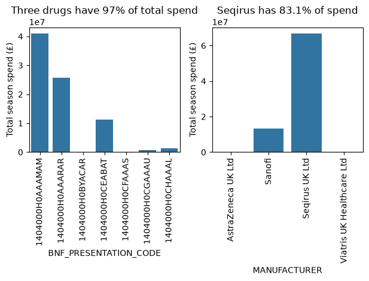
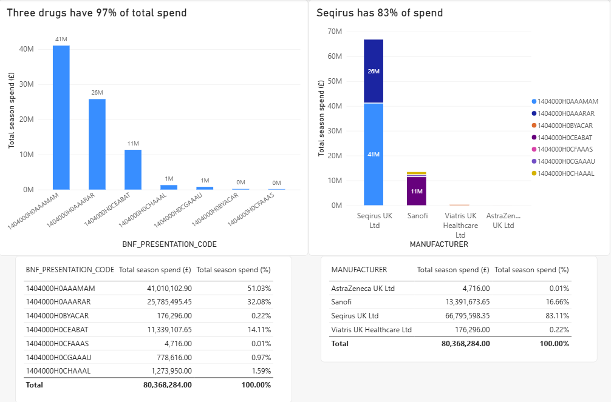

# 01 – Flu vaccination visual

Rebuilding a pair of charts from an earlier exploratory analysis of NHS flu vaccination spending, originally made in pandas and Seaborn, as a Power BI report.

## Data

The data is the NHSBSA Community Pharmacy Adult Seasonal Influenza Vaccination Service report for December 2025. It covers vaccines given by community pharmacies from September to December 2025: about 25,000 rows, each showing one pharmacy's use of one vaccine product.

- Dataset: [December 2025 report](https://opendata.nhsbsa.net/dataset/community-pharmacy-adult-seasonal-influenza-vaccination-service-report-pharmacy-contractors/resource/792613ac-7561-4757-8c05-71e850445f04)
- Info page: [NHSBSA open data portal](https://opendata.nhsbsa.net/dataset/community-pharmacy-adult-seasonal-influenza-vaccination-service-report-pharmacy-contractors)

To recreate the input, download the CSV and place it in the top-level `data/` folder.

## What was rebuilt

The original analysis in pandas found that £80 million was spent on flu vaccines through the service, and that the spend was concentrated:

- Three of the seven drugs (identified by BNF presentation code) account for 97% of total spend.
- One manufacturer, Seqirus UK Ltd, receives 83% of total spend.

Both findings were shown as bar charts of total season spend, one by drug and one by manufacturer.

## Python original vs Power BI rebuild

| Python (Seaborn) | Power BI |
|---|---|
|  |  |

Differences in the Power BI version:

- **Sorting:** bars are sorted by spend rather than alphabetically, so the "three drugs" finding is visible at a glance.
- **Readability:** data labels and axis units in millions replace the scientific-notation axis (1e7) in the Python version.
- **Stacking:** the manufacturer chart is stacked by drug, showing which products make up each manufacturer's spend. The Python version needed a separate calculation and written notes to show this.
- **Summary tables:** tables with the share of total spend replace the percentages that were printed in the notebook.

## Notes

- **Percentage column:** adding the share-of-total column to the summary tables gave me some trouble. I first tried a visual calculation written in DAX, before finding that the same field can be added to the table a second time from the Visualizations pane, set to Sum, and shown as "Percent of grand total". In pandas this was a single division.
- **What I'd do differently:**
  - Replace the BNF codes with vaccine names in the axis labels and legend, so readers can tell the drugs apart without looking up codes.
  - Fix the data labels so small values aren't rounded to "0M", which reads as zero spend.
  - Sort the summary tables by spend to match the charts, instead of by code or name.
