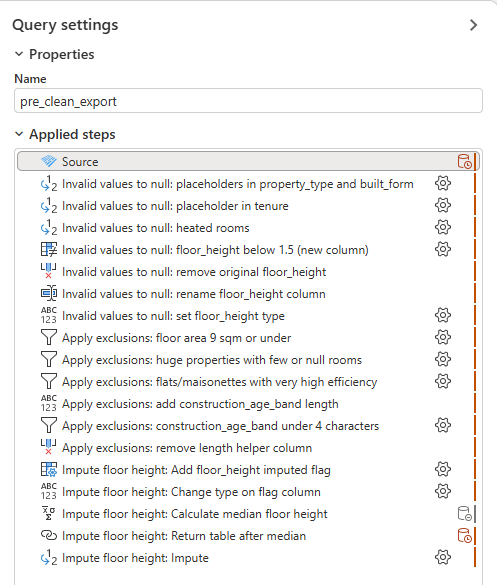

# 02 – Power Query: cleaning stage

Re-implementing the cleaning stage of my UK Land Registry and EPC pipeline in Power Query, and comparing it with the original pandas version.

## Data

The input is the matched Price Paid and EPC dataset just before cleaning (91,150 sales). It isn't included because the EPC data licence restricts sharing address data.

To recreate it:

1. Run `export_pre_clean.py` in [land-registry-cleaning-pipeline](https://github.com/TomSCarter/land-registry-cleaning-pipeline) (see that repo's README for setup).
2. Copy `data/processed/pre_clean_export.parquet` into this repo's top-level `data/` folder.
3. Open the project in Power BI Desktop. In the Power Query Editor, go to Home > Manage Parameters and set the `DataFolder` parameter to the full path of your `data/` folder, including the trailing backslash.

## Spec

Written from `clean.py` before building, so each Power Query step can be compared with the pandas version.

1. Convert invalid values to null
    1. Placeholders converted to null: `property_type` and `built_form` 'Not Recorded', `tenure` 'unknown'
    2. `number_heated_rooms` = 0 converted to null
    3. `floor_height` < 1.5 m converted to null
2. Apply exclusions (as rules)
    1. Exclude `total_floor_area` <= 9 sqm
        - Keep: `total_floor_area` > 9
    2. Exclude `total_floor_area` > 2000 AND (`number_habitable_rooms` <= 7 OR `number_habitable_rooms` is missing)
        - Keep: `total_floor_area` <= 2000 OR (`number_habitable_rooms` > 7 AND `number_habitable_rooms` is not null)
    3. Exclude `current_energy_efficiency` > 110 AND `energy_consumption_current` > 200 AND `property_type` in [Flat, Maisonette]
        - Keep: `current_energy_efficiency` <= 110 OR `energy_consumption_current` <= 200 OR `property_type` not in [Flat, Maisonette]
    4. Exclude `construction_age_band` shorter than 4 characters (no nulls in this column)
        - Keep: length >= 4
3. Impute `floor_height` with the median of non-null values (calculated after nulls are set and exclusions are applied), and add a `floor_height_imputed` flag (True for imputed, False otherwise)

## Reconciliation with the pandas pipeline

| Check | pandas pipeline | Power Query |
|---|---|---|
| Rows before exclusions | 91,150 | 91,150 |
| Nulls after conversion: heated rooms / floor height / tenure / built_form | 29,603 / 2,046 / 21,458 / 2,040 | 29,603 / 2,046 / 21,458 / 2,040 |
| Rows excluded (by rule) | 7 (total only) | 7 (1 / 3 / 0 / 3) |
| Median floor height used | 2.37 m | 2.37 m |
| Floor heights imputed | 2,046 | 2,046 |
| Final rows | 91,143 | 91,143 |

The pandas pipeline only reports the total number of exclusions. Applying each rule as a separate step in Power Query confirmed the per-rule split found in the earlier analysis.

## Applied steps

Full query: [Link](https://github.com/TomSCarter/powerbi_training_log/blob/main/02_power_query_clean_stage/02_power_query_clean_stage.SemanticModel/definition/tables/pre_clean_export.tmdl)

## Notes

- An empty text box in Replace Values gives "", an empty string, not null. You have to type null
- Comparisons like < and > return null if the value is null, and an if statement errors on null, so the non-null check has to come first in the condition
- First load of the query failed due to using Replacer.ReplaceText instead of Replacer.ReplaceValue (needed for swapping in null). ReplaceValue is what you get by ticking "Match entire cell contents" under advanced options
- The filter UI keeps rows rather than excluding them, so the exclusion rules had to be reversed. Learnt how to do this with De Morgan's laws: AND becomes OR and each condition is negated (<= becomes >). M does have `not`, so in the formula bar the original rule could have been wrapped in `not (...)` instead
- Had to return to the table after computing the median floor_height, as the UI builds each step on the previous one
- Comparison with pandas
    - Thresholds are hardcoded rather than in a config file
    - It is slow switching between steps, with the table reloading each time. Had to restart the program a couple of times when it stopped running properly
    - Using the UI is clunky and doesn't give you the options available by typing M directly in the formula bar
    - Simple filters are easier, like filtering by the length column made from construction_age_band
    - Seeing the values in a table to scroll around was easier
    - Switching data type for the columns was easier

## Time taken

About 3–4 hours, against a 2–3 hour estimate. The extra time went on null handling in M, the error rows, and reversing the exclusion rules.
